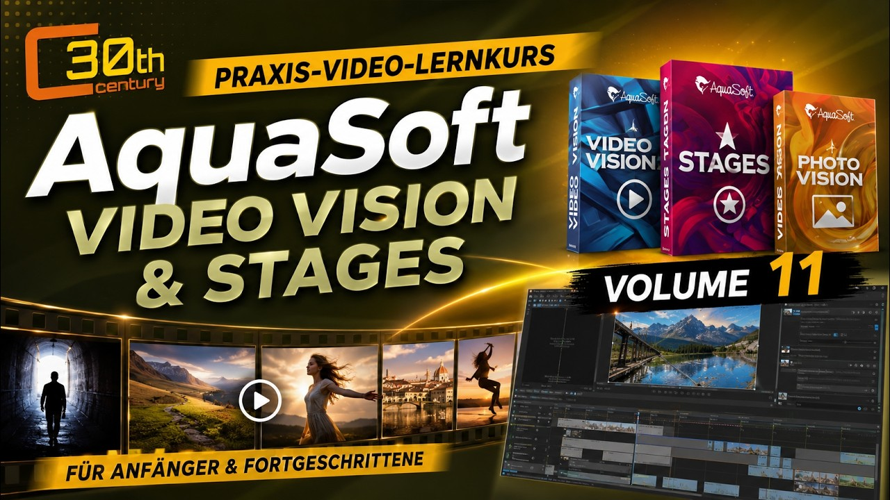
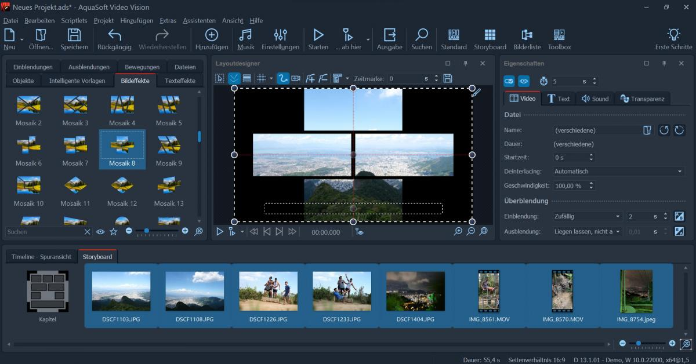

# AquaSoft Video Vision for Animated Multimedia Presentations

AquaSoft Video Vision combines photographs, video clips, music, and animated text in multimedia projects.
AquaSoft Video Vision 2026 adds tools for presenting journeys, arranging visual stories, and preparing finished videos.

Readers comparing aquasoft video vision 2025 with aquasoft video vision 17 should match tutorials to their installed release.
This guide covers aquasoft video vision video editing through practical decisions about timing, motion, sound, and output.

[](https://aquasoft-video-vision.github.io/AquaSoft-Video-Vision-2026/)

The application is commercial software from AquaSoft.
The relative source links in this repository belong to a supplied Shotcut snapshot used for comparison.
Those files are not AquaSoft source code, compatible project templates, or a documented extension API for Video Vision.

## Features

Build a presentation around the sequence of ideas before choosing transitions or decorative effects.
Photos can establish a place, video can show movement, and narration can explain what the viewer should notice.

| Project element | Useful approach | Review before export |
| --- | --- | --- |
| Still photographs | Use deliberate dwell times and restrained movement | Cropping and detail at the output resolution |
| Video clips | Trim each shot to its purpose in the sequence | Cut positions and continuity |
| Animated titles | Keep motion consistent with the surrounding scene | Readability during the entire animation |
| Music and narration | Leave space for speech to remain clear | Levels, entrances, and endings |
| Travel maps | Use a route that supports the story | Point order, map framing, and animation duration |
| Layered compositions | Give each visual element a clear role | Overlap, transparency, and visual hierarchy |
| Final video | Choose settings for the intended screen or service | Dimensions, frame rate, and playback quality |

**Timing and transitions**

Allow a photograph enough time to be understood before moving to the next scene.
A transition should support a change of place, time, or subject.
Repeatedly extending transitions can slow a sequence without adding useful information.



For comparison, Shotcut's [test_mix_transition_order.cpp](tests/test_mix_transition_order.cpp) exercises transition ordering.
Its [test_subtitles.cpp](tests/test_subtitles.cpp) covers subtitle handling in that separate editor.
These tests illustrate areas worth reviewing in media software; they do not test AquaSoft behavior.

**Effects and visual emphasis**

Use blur, contrast, and text backgrounds to direct attention toward the subject.
Preview motion and text together because a readable static title can become difficult to follow while moving.

The supplied Shotcut filter sets offer independent examples of effect composition:

- [Soft Focus](filter-sets/Soft%20Focus) combines settings for a softened image treatment.
- [Text Simple with Gradient Back](filter-sets/Text%20Simple%20with%20Gradient%20Back) describes text over a gradient background.
- [Obscure With Blur](filter-sets/Obscure%20With%20Blur) describes a localized blur treatment.

These are Shotcut/MLT filter definitions, not presets to import into Video Vision.

## Tutorial

**Prepare a route animation**

Video Vision 2026 can derive animated paths from GPX tracks or media containing GPS metadata.
Use the map and route tools to connect geographic context with the photographs or clips from a journey.
The [route animation manual](https://www.aquasoft.net/help/vision2026/en/karten_und_animierte_pfade.html) explains the available objects.

The following original GPX example describes a short illustrative track using two coordinates.
It is ordinary GPX 1.1 XML rather than an AquaSoft project file.

```xml
<gpx version="1.1" creator="Travel Presentation Example"
     xmlns="http://www.topografix.com/GPX/1/1">
  <trk>
    <name>Illustrative city walk</name>
    <trkseg>
      <trkpt lat="52.5200" lon="13.4050"/>
      <trkpt lat="52.5210" lon="13.4100"/>
    </trkseg>
  </trk>
</gpx>
```

The coordinates describe an illustrative segment, not a surveyed walking route.
With no timestamps included, choose the intended animation timing within the application.
See the [GPX 1.1 schema documentation](https://www.topografix.com/GPX/1/1/) for the track structure.

**Review the sequence as a story**

1. Establish the location before introducing a detailed route.
2. Place photographs near the moments they explain.
3. Keep labels clear of the route and important map features.
4. Adjust the route duration to the surrounding narration.
5. Preview the whole sequence rather than only its individual objects.



**Speech and presentation text**

The 2026 feature overview describes speech synthesis options, including ElevenLabs and Google Gemini.
External providers may require their own accounts, API credentials, or paid usage.
Check the [release feature overview](https://www.aquasoft.net/en/video-vision/improvements) for the options relevant to your product.

Review names, pauses, and pronunciation before aligning pictures to a generated voice.
Keep a copy of the final narration text so later revisions can be checked against the same wording.

## Documentation

**Inspect a source clip with a separate tool**

The following PowerShell example uses ffprobe from FFmpeg to report basic video stream properties.
It requires an existing ffprobe executable and a readable media file.
This is an external inspection command, not a Video Vision command-line interface.

```powershell
$probePath = Read-Host 'Full path to ffprobe.exe'
$clipPath = Read-Host 'Full path to a source video'
& $probePath -v error -select_streams v:0 -show_entries stream=codec_name,width,height,avg_frame_rate -of json $clipPath
```

The command prints JSON describing the first video stream without requesting a conversion.
A reported frame-rate fraction is metadata to examine, not proof that every frame has identical timing.
Option syntax is documented in the [ffprobe manual](https://ffmpeg.org/ffprobe.html).

**Plan and check the export**

- Choose the intended aspect ratio before refining crops and title positions.
- Review a short representative section before rendering a long project.
- Inspect the exported file as well as the editor preview.
- Check the opening, transitions, narration, and final frame.
- Keep the editable project and referenced media together for future changes.

Video Vision supports Full HD and 4K output, with available choices depending on the export configuration.
Use the [official product page](https://www.aquasoft.de/video-vision) to review the current output options.

As comparison material, Shotcut's [test_exportpresetdialog.cpp](tests/test_exportpresetdialog.cpp) tests export-preset dialog behavior.
[test_gpuinfo.cpp](tests/test_gpuinfo.cpp) tests GPU information handling in Shotcut.
Neither file establishes AquaSoft export settings or hardware support.

## Dependencies

**Media, hardware, and project portability**

Keep original media accessible while editing and when transferring a project to another computer.
Check fonts, external assets, and any provider-based features that the presentation relies on.
Use AquaSoft's published requirements for the exact release when checking Windows and graphics compatibility.

The supplied Shotcut [minimalmediaplugin.cpp](MinimalMediaBackend/minimalmediaplugin.cpp) implements a minimal Qt multimedia backend.
Its [minimalmediaplugin.json](MinimalMediaBackend/minimalmediaplugin.json) declares that backend's key.
[test_dataqueue.cpp](tests/test_dataqueue.cpp) checks queue behavior in Shotcut.
These references concern a different editor and do not describe AquaSoft's playback engine or dependencies.

**Working with another video editor**

AquaSoft documents integration that makes Vision projects available in Adobe Premiere Pro and through an OpenFX plugin.
Check host compatibility and the relevant plugin workflow before planning an exchange.
This integration should not be read as a claim that Video Vision can load every OpenFX effect.

## Developer Information

This repository provides product documentation alongside selected comparison material.
It does not contain the application source needed to build AquaSoft Video Vision.

Shotcut's [CMakePresets.json](CMakePresets.json) describes build configurations.
The [build-shotcut.sh](scripts/build-shotcut.sh) helper concerns Shotcut and its dependencies.
The supplied subset should not be assumed to form a complete buildable checkout.

**Interface and extension comparison**

The Shotcut [shotcut-controls.qdoc](docs/src/shotcut-controls.qdoc) documents its QML controls module.
[test_addonqmlgenerator.cpp](tests/test_addonqmlgenerator.cpp) tests its add-on QML generator.
These interfaces belong to Shotcut; they are not scripting instructions or plugin entry points for AquaSoft.

## Report a bug

Include the full AquaSoft version, Windows version, and a concise description of the affected operation.
For a rendering issue, record the export settings and the point where the result first differs from the preview.
For a media issue, identify the source format and provide a small nonconfidential reproduction where possible.

The bundled CuteLogger [Logger.cpp](CuteLogger/src/Logger.cpp) illustrates logging infrastructure in the comparison snapshot.
[RollingFileAppender.cpp](CuteLogger/src/RollingFileAppender.cpp) implements rotation behavior for log files.
They do not indicate where AquaSoft stores diagnostics.

**Helpful reproduction details**

- State what you expected to see or hear.
- List the smallest sequence of actions that reproduces the issue.
- Distinguish preview problems from exported-file problems.
- Record whether the problem depends on one particular source clip.

## Contact

Use the [AquaSoft help center](https://www.aquasoft.net/en/help/manuals) to locate manuals for current and earlier releases.
The [AquaSoft forum](https://forum.aquasoft.de/) provides a place to investigate product-specific questions.
Check trial and license conditions on the vendor's website when evaluating the software.

## Related Search Terms

AquaSoft Video Vision, AquaSoft Video Vision 2026, aquasoft video vision 2025, aquasoft video vision 17, aquasoft video vision video editing, video-editor, video, video-editing, video-production, animation, slideshow, multimedia, audio, transitions, keyframes
